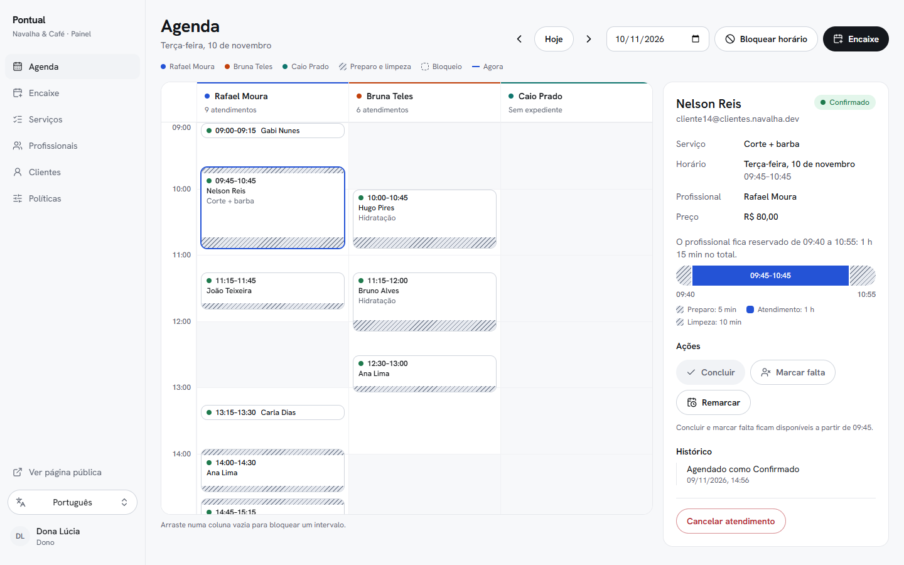
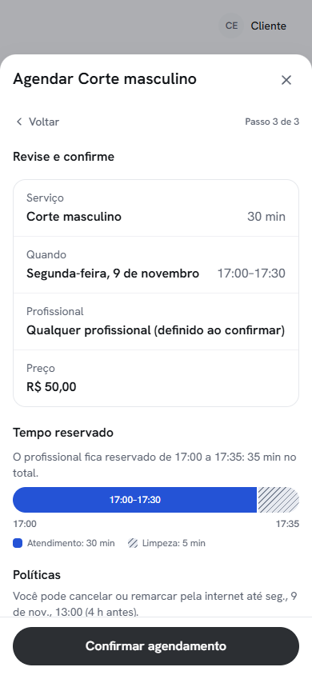
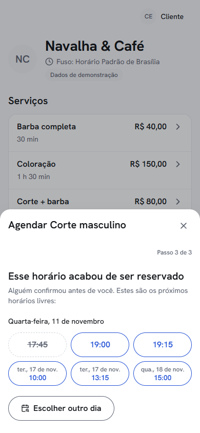
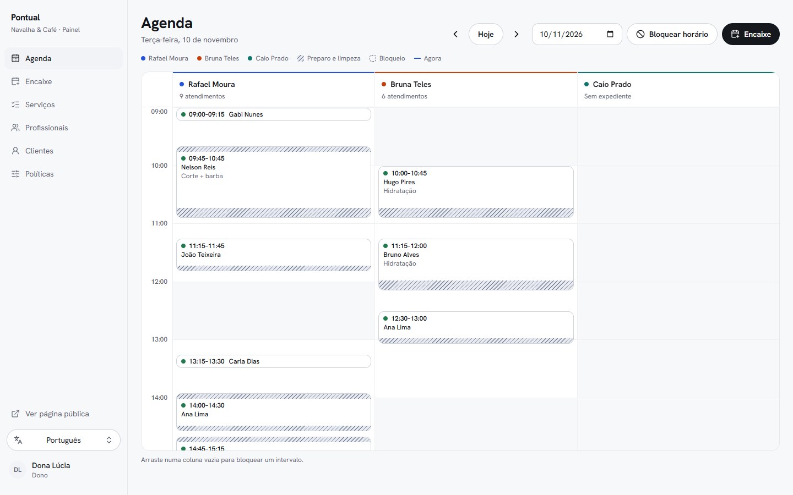
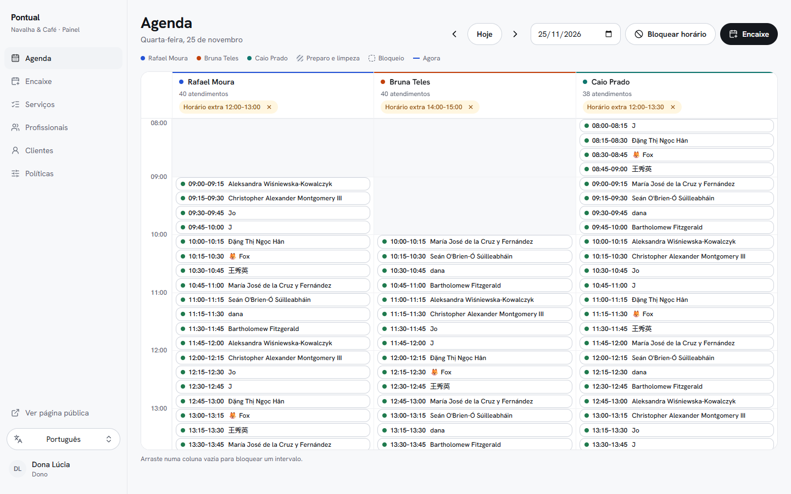
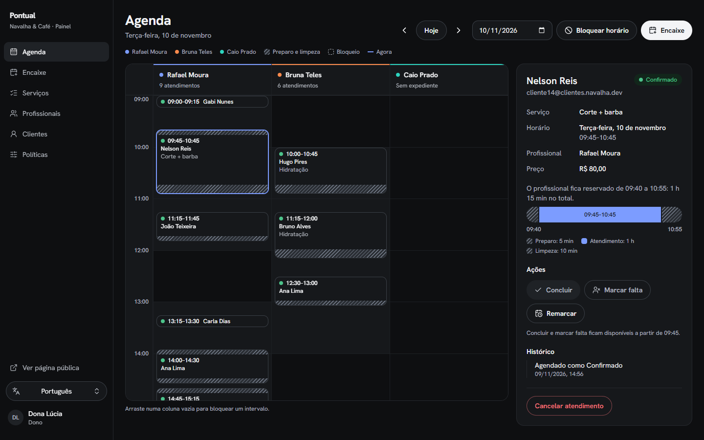
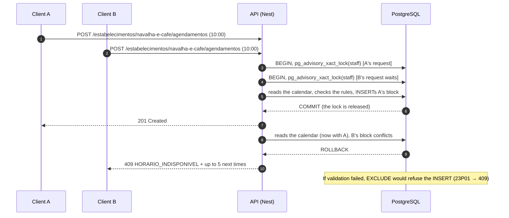
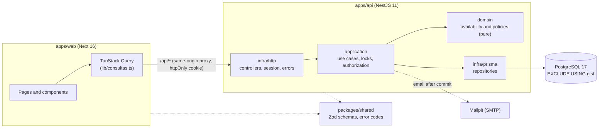

# Pontual: online booking that never lets the same slot be booked twice

[Versão em português](README.md)



Pontual is a booking system for businesses that run on appointments (barbershops, salons,
clinics). Clients book on their own from their phone; the business follows the calendar in a
dashboard. The project demonstrates three things:

- **Business rules modelled in full:** 24 rules with IDs (RN-01 to RN-24), a pure availability
  engine tested against an oracle, and every refusal with a code, a message and a next step.
- **The single-slot guarantee lives in the database:** an `EXCLUDE USING gist` constraint in
  PostgreSQL, proven under concurrency (20 simultaneous requests give 1 booking and 19 refusals,
  over 10 rounds).
- **A careful interface on both sides:** booking on the phone and a front-desk dashboard,
  Portuguese and English, light and dark themes, WCAG 2.2 AA checked with axe, offline mode and the
  worst case tested.

The product's UI language is Brazilian Portuguese by default (with an English switch), and the code,
docs and test names are in Portuguese.

## Screens

|                                                                                                                                                                   |                                                                                                                                                                                    |
| ----------------------------------------------------------------------------------------------------------------------------------------------------------------- | ---------------------------------------------------------------------------------------------------------------------------------------------------------------------------------- |
|                      |  |
| **Picking a time.** Availability comes from the API, in the business's time zone.                                                                                 | **Review.** The occupied block shows how long the staff member is reserved, with preparation and cleanup.                                                                          |
|                                 |     |
| **A refusal with a way out.** If someone confirmed first, the same sheet offers the next free times.                                                              | **Dashboard.** The day's calendar in a custom grid, with blocks, days off and the "now" line.                                                                                      |
|  |                                                                           |
| **The real worst case.** 40 fifteen-minute appointments per staff member, created by `db:seed:pior-caso`.                                                         | **Dark theme.** A complete theme, with the same colour roles.                                                                                                                      |

## Run it in 3 commands

Requirements: Docker and Node 22 (pnpm comes from corepack; nothing is installed globally).

```bash
docker compose up -d
corepack pnpm install
corepack pnpm demo
```

`demo` creates `.env` from `.env.example` (if missing), applies the migrations
(`prisma migrate deploy`), runs the seed and starts the API and the web app together. When both
respond, it prints:

| What                                       | Where                                  |
| ------------------------------------------ | -------------------------------------- |
| Booking page (client)                      | http://localhost:3000/b/navalha-e-cafe |
| Sign in (dashboard and "my bookings")      | http://localhost:3000/entrar           |
| API and Swagger                            | http://localhost:3333/docs             |
| Confirmation and reminder emails (Mailpit) | http://localhost:8025                  |

Demo accounts, all with the password `demo1234`:

| Account                   | What it sees                                     |
| ------------------------- | ------------------------------------------------ |
| `dono@agenda.dev`         | the full dashboard of "Navalha & Café" (owner)   |
| `profissional@agenda.dev` | Rafael Moura's dashboard (only his own calendar) |
| `cliente@agenda.dev`      | bookings and "my bookings" (client)              |

The sign-in page has a "Sign in as…" button for each account (it only fills in the form). The data
is demo data: one business, 3 staff members, 6 services and two partly booked weeks.
`corepack pnpm --filter @agenda/api db:seed:pior-caso` fills one day with 40 appointments per staff
member.

## How I guarantee there are no double bookings

Conflicts are stopped in three layers, and each one is tested on its own.

**1. The pure domain** (`apps/api/src/domain`). The availability engine knows nothing about Nest,
Prisma or the clock: "now" is passed in as a parameter. Every interval is half-open,
`[start, end)`, so ending at 10:00 does not conflict with starting at 10:00 (RN-01). An appointment
occupies the **block** `[start − preparation, end + cleanup)`, and the whole block must fit in the
working hours (RN-06, RN-07, D-02, D-03). The offered times are compared, minute by minute, with a
naive oracle in 6 time zones on daylight-saving dates.

**2. The transaction** (`apps/api/src/application`). Booking, rescheduling and blocking take a
`pg_advisory_xact_lock` per staff member (and per client, because of the active-bookings limit) in
alphabetical key order, **before** reading any data that will be validated. Only then is the rule
checked and the row written. "Any staff member" locks every candidate and, if the chosen one fails,
tries the next one within the same request, using a SAVEPOINT (D-05, D-13).

**3. The database** (`apps/api/prisma/migrations/20261108194040_exclusao_agendamentos/migration.sql`).
Even if a bug got past the two layers above, PostgreSQL refuses the overlap:

```sql
CREATE EXTENSION IF NOT EXISTS btree_gist;

ALTER TABLE "Agendamento"
  ADD CONSTRAINT agendamento_sem_sobreposicao
  EXCLUDE USING gist (
    "profissionalId" WITH =,
    tstzrange("inicioBloco", "fimBloco", '[)') WITH &&
  ) WHERE (status <> 'CANCELADO');
```

The violation (SQLSTATE `23P01`) becomes `409 HORARIO_INDISPONIVEL`, with up to 5 next free times.



**Idempotency (RN-22).** The screen generates one `Idempotency-Key` per confirmation attempt.
Clicking again, or resending after a network failure, uses the same key, and the API returns the
original response without creating another booking; picking a new time creates a new key. The key
is reserved in the same transaction as the booking and is valid for 24 h.

### The proofs

| Proof                                                                                                                        | Result                                                              | Test                                                                             |
| ---------------------------------------------------------------------------------------------------------------------------- | ------------------------------------------------------------------- | -------------------------------------------------------------------------------- |
| 20 simultaneous requests for the same time                                                                                   | 1 success and 19 × 409, over 10 rounds                              | [`concorrencia.test.ts`](apps/api/test/integracao/concorrencia.test.ts) (C1)     |
| "Any staff member" in parallel, with 3 staff members                                                                         | 3 successes and 17 × 409                                            | [`concorrencia.test.ts`](apps/api/test/integracao/concorrencia.test.ts) (C2)     |
| A raw, overlapping SQL INSERT, outside the application                                                                       | stopped by the constraint (23P01)                                   | [`garantia-banco.test.ts`](apps/api/test/integracao/garantia-banco.test.ts) (C3) |
| Mixed load: 15 rounds × 40 operations (book, reschedule with a staff change, cancel, block)                                  | 0 overlaps, 0 deadlocks, 0 exceptions                               | [`rodada2.test.ts`](apps/api/test/validacao/rodada2.test.ts) (R3)                |
| The same `Idempotency-Key` 10 times in parallel                                                                              | 1 booking and 10 identical responses                                | [`idempotencia.test.ts`](apps/api/test/integracao/idempotencia.test.ts) (C4)     |
| Authorization without TOCTOU: the owner moves the appointment to another staff member while the first one tries to cancel it | 403 and nothing changes                                             | [`http-toctou.test.ts`](apps/api/test/integracao/http-toctou.test.ts)            |
| Two browsers pick the same time                                                                                              | the second sees the sheet with the next times and books one of them | [`cliente.spec.ts`](apps/web/e2e/cliente.spec.ts) (test 4)                       |
| The network drops during confirmation                                                                                        | the resend uses the same key and does not duplicate                 | [`teclado-offline.spec.ts`](apps/web/e2e/teclado-offline.spec.ts)                |

### What the independent Validator broke

The domain and persistence phases were done as a trio: an Executor, a Planner and a Validator who
did not see the conversation and tried to break the rules.

- **Phase 1 (domain):** the Validator wrote 100 tests of its own (93 edge cases, plus properties
  checked against a minute-by-minute oracle in 6 time zones with daylight saving) and found no
  failure. It raised 7 ambiguities, decided in D-12.
- **Phase 2 (persistence), two real failures:**
  - **RN-17 bypassed under concurrency (high).** The client was read before the lock, and parallel
    requests went past the active-bookings limit. Fix: lock `cliente:<id>` before any read.
  - **Instants depended on the PostgreSQL session time zone (medium).** The adapter wrote shifted
    values when the database was not in UTC. Fix: `SET TIME ZONE 'UTC'` on every new connection;
    there is a test with the database in `Asia/Tokyo`.

  In the second round the Validator passed 76 out of 76 over three runs, including the mixed load.

- **Phase 3 (API):** the Planner's review demanded a fix for a TOCTOU the Executor had flagged as a
  risk: an appointment's authorization was read outside the transaction. It now runs again on the
  locked row (`SELECT … FOR UPDATE`), and a deterministic test proves it; without the fix, the 3
  race tests fail.

The history is in [`docs/decisoes.md`](docs/decisoes.md) (D-11 to D-15, in Portuguese).

## Business rules

The detail is in [`docs/regras-de-negocio.md`](docs/regras-de-negocio.md) (in Portuguese), with the
full traceability matrix.

| Rule         | What it guarantees                                                                              | Where it is tested               |
| ------------ | ----------------------------------------------------------------------------------------------- | -------------------------------- |
| RN-01        | half-open intervals: touching is not a conflict                                                 | unit, property, integration      |
| RN-02        | instants in UTC; day, grid and booking window in the business's time zone, with daylight saving | unit, property, integration      |
| RN-03, RN-04 | weekly working hours; day off, holiday and extra hours                                          | unit, property, integration      |
| RN-05        | a one-off block makes the time unavailable                                                      | unit, integration                |
| RN-06        | the occupied block includes preparation and cleanup; cancelling frees it at once                | unit, property, integration, e2e |
| RN-07, RN-08 | time grid; the whole service must fit                                                           | unit, property                   |
| RN-09, RN-10 | minimum notice and maximum booking window                                                       | unit, property                   |
| RN-11, RN-12 | the staff member offers the service; "any staff member" picks the least busy                    | unit, integration                |
| RN-13        | the server revalidates everything; a refusal brings the next times                              | unit, property, integration, e2e |
| RN-14        | the booking keeps a copy of the service                                                         | unit, integration                |
| RN-15, RN-16 | cancellation deadline; atomic rescheduling                                                      | unit, property, integration, e2e |
| RN-17, RN-18 | active-bookings limit; blocking after no-shows                                                  | unit, integration                |
| RN-19        | lifecycle with history                                                                          | unit, integration, e2e           |
| RN-20        | the front desk skips notice and window, not the past                                            | unit, property                   |
| RN-21        | the database guarantee (EXCLUDE)                                                                | integration                      |
| RN-22        | idempotency                                                                                     | integration, e2e                 |
| RN-23        | roles (owner, staff, client), without leaking other people's resources                          | unit, integration                |
| RN-24        | confirmation email and a reminder 24 h before                                                   | integration                      |

| Code                               | HTTP |     | Code                             | HTTP |
| ---------------------------------- | ---- | --- | -------------------------------- | ---- |
| `HORARIO_INDISPONIVEL`             | 409  |     | `CLIENTE_BLOQUEADO`              | 403  |
| `FORA_DO_EXPEDIENTE`               | 422  |     | `TRANSICAO_DE_STATUS_INVALIDA`   | 422  |
| `HORARIO_FORA_DA_GRADE`            | 422  |     | `CHAVE_IDEMPOTENCIA_REUTILIZADA` | 422  |
| `ANTECEDENCIA_MINIMA`              | 422  |     | `ACESSO_NEGADO`                  | 403  |
| `HORARIO_NO_PASSADO`               | 422  |     | `NAO_ENCONTRADO`                 | 404  |
| `ALEM_DO_HORIZONTE`                | 422  |     | `DADOS_INVALIDOS`                | 400  |
| `PROFISSIONAL_NAO_EXECUTA_SERVICO` | 422  |     | `NAO_AUTENTICADO`                | 401  |
| `PRAZO_DE_CANCELAMENTO_ENCERRADO`  | 422  |     | `ERRO_INTERNO`                   | 500  |
| `LIMITE_DE_AGENDAMENTOS`           | 422  |     |                                  |      |

The front end turns each code into a message and an action, in both languages, from the `codigo`
(never from the API's text).

## Architecture



- **pnpm monorepo:** `packages/shared` (Zod schemas for requests and responses, error codes),
  `apps/api` and `apps/web`.
- **Layered API:** `domain` (pure), `application` (use cases, transaction, authorization) and `infra`
  (HTTP, Prisma, email, jobs, seed). Controllers only validate with Zod and call the operations;
  none of them imports Prisma.
- **Why the domain is pure and receives "now":** the rules depend on time (notice, booking window,
  deadline, daylight saving). With the clock as a parameter, every edge case becomes a deterministic
  test, and the properties (fast-check) cover thousands of scenarios without waiting for the clock.
  Only `infra/relogio.ts` reads `Date.now()`.
- **Front end:** the browser calls `/api/...` on its own origin (a Next rewrite), so the session
  cookie is first-party. Responses are validated with the `shared` schemas. Dates and times are
  always shown in the business's time zone.

**Stack:** Node 22, TypeScript 6.0, pnpm 10 · NestJS 11, Prisma 7.10, PostgreSQL 17, Luxon 3.7,
argon2 · Next 16.4, React 19.3, TanStack Query 5, Tailwind 4.3, base-ui 1.9, next-intl 4, Zod 4.6,
react-hook-form · Vitest 5, fast-check 4, Playwright 1.65 with axe-core.

**Production build:** `corepack pnpm --filter @agenda/web build` builds the web app. The API has no
build step: it runs with SWC transpiling on load (`corepack pnpm --filter @agenda/api start`).
`shared` exports TypeScript source and Nest needs `emitDecoratorMetadata`, so a bundled API build
needs a bundler with SWC and was left out (D-10, D-19).

## Tests

Numbers from the latest run:

| Suite                                                                           | Tests           | How to run                                                     |
| ------------------------------------------------------------------------------- | --------------- | -------------------------------------------------------------- |
| Domain and application (unit)                                                   | 186             | `corepack pnpm --filter @agenda/api test`                      |
| fast-check properties (P1–P7, 500 runs each, and VP1–VP6 against the oracle)    | 13              | same (included in the API total: 199)                          |
| Shared (error codes 1:1 with the table)                                         | 4               | `corepack pnpm --filter @agenda/shared test`                   |
| Web (time zone, dictionaries, errors, Idempotency-Key, times, initials)         | 33              | `corepack pnpm --filter @agenda/web test`                      |
| Integration and the Validator's suite (real PostgreSQL, `agenda_test` database) | 114 in 15 files | `corepack pnpm test:integration`                               |
| E2E (Playwright, real API and seed, `agenda_e2e` database)                      | 13              | `corepack pnpm test:e2e`                                       |
| … of which a11y (axe, WCAG 2.2 AA, 13 screens in light and dark)                | 4               | `corepack pnpm --filter @agenda/web exec playwright test a11y` |

`corepack pnpm test` runs all unit suites. The E2E tests cover booking, rescheduling, cancelling,
the 409 refusal with two browsers, the dashboard, switching language in a browser set to another
time zone, booking with the keyboard only and offline mode. Integration and E2E need the
`docker compose` PostgreSQL.

## Decisions

All in [`docs/decisoes.md`](docs/decisoes.md) (in Portuguese). The ones that matter most:

- **D-02:** the occupied block includes the preparation, and the constraint uses the whole block.
- **D-05:** blocks and bookings are not in the same table, so the same per-staff lock protects both.
- **D-13:** the exclusion constraint lives in a hand-written SQL migration, because Prisma does not
  model `EXCLUDE`; it comes with the lock, SAVEPOINT and idempotency decisions.
- **D-16:** the design direction and the name Pontual.
- **D-17:** the front end: same-origin proxy, i18n without a route prefix, the business's time zone
  and one Idempotency-Key per attempt.

## Design

The direction is the category's standard, chosen on purpose and executed with care, with Booksy as
the bar: users know where everything is before they notice the style. What sets it apart are three
elements of its own: the occupied block, the refusal with the next times and the aligned numbers.
The details are in [`DESIGN.md`](DESIGN.md) (tokens, components and rules) and the product context in
[`PRODUCT.md`](PRODUCT.md), both in Portuguese.

## Structure

```
apps/
  api/            NestJS: domain/ (pure), application/ (use cases), infra/ (http, prisma, seed)
    prisma/       schema, migrations (including the EXCLUDE one) and seeds
    test/         integration and the Validator's suite
  web/            Next: app/ (routes), components/, lib/, messages/ (pt-BR and en), e2e/
packages/
  shared/         Zod schemas and error codes
docs/             business rules, decisions and screenshots
scripts/demo.mjs  the "run it in 3 commands" script
```

## Credits and licence

A portfolio project, the second of four. The licence has not been chosen yet: the repository has no
licence file for now.
