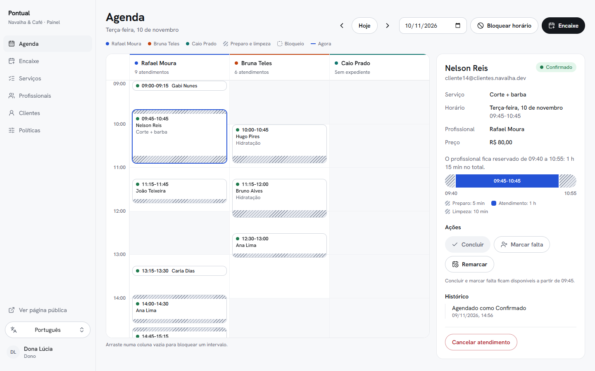
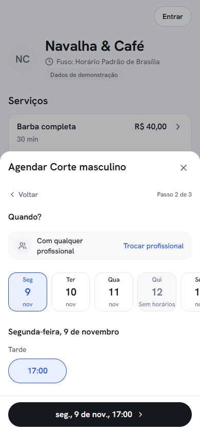
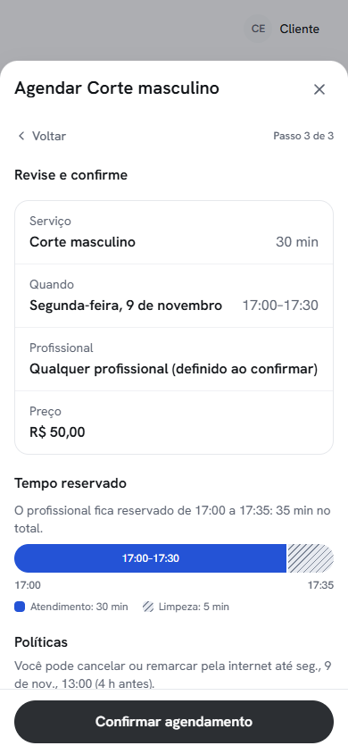
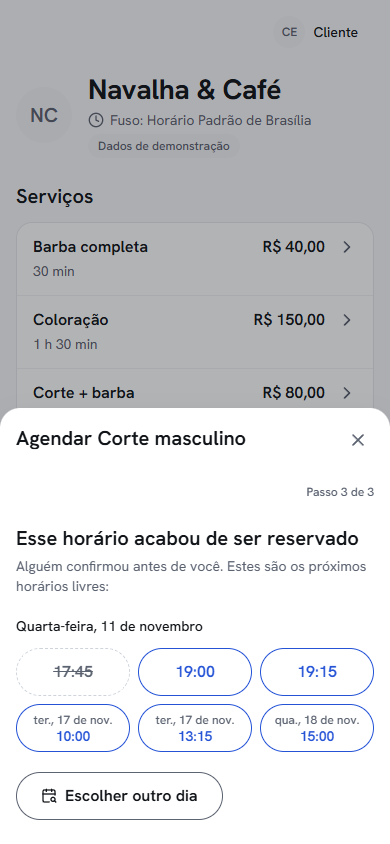
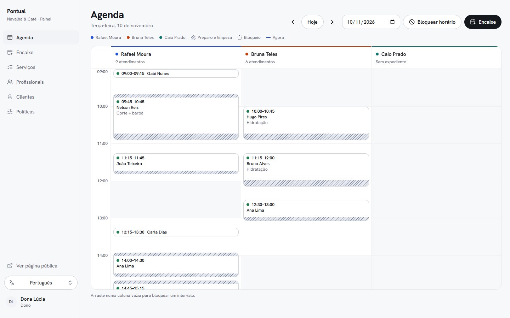
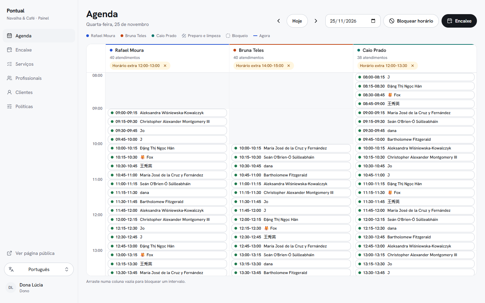
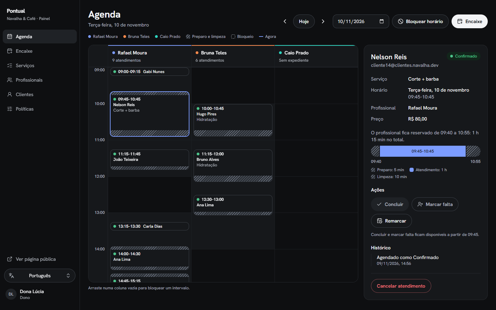
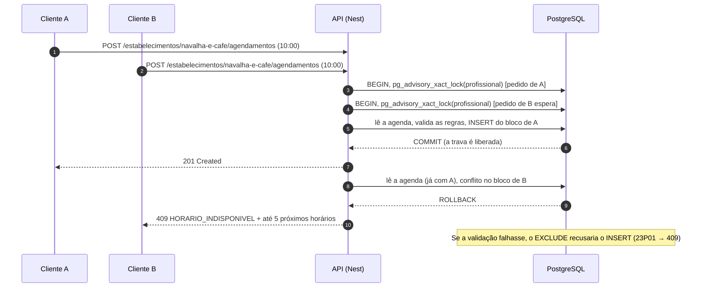
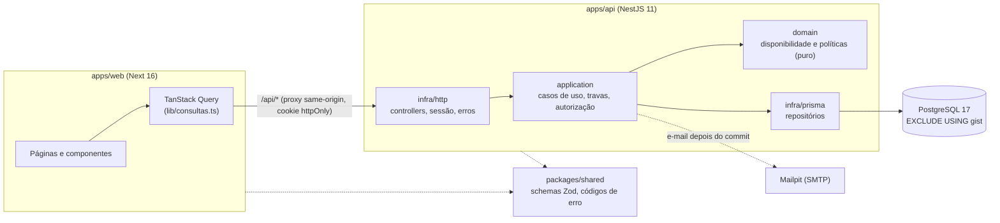

# Pontual: agendamento online que não deixa marcar duas vezes o mesmo horário

[English version](README.en.md)



O Pontual é um sistema de agendamento para negócios que vivem de horário marcado (barbearia,
salão, clínica). O cliente reserva sozinho pelo celular; o estabelecimento acompanha a agenda num
painel. O projeto demonstra três coisas:

- **Regras de negócio modeladas por inteiro:** 24 regras com ID (RN-01 a RN-24), um motor de
  disponibilidade puro e testado contra um oráculo, e cada recusa com código, mensagem e próxima
  ação.
- **A garantia de horário único no banco:** uma constraint `EXCLUDE USING gist` no PostgreSQL,
  provada sob concorrência (20 pedidos simultâneos dão 1 reserva e 19 recusas, em 10 rodadas).
- **Uma interface cuidada nos dois lados:** reserva no celular e painel no balcão, pt-BR e inglês,
  tema claro e escuro, WCAG 2.2 AA verificado com axe, modo offline e o pior caso testado.

## Telas

|                                                                                                                                                                  |                                                                                                                                                                                |
| ---------------------------------------------------------------------------------------------------------------------------------------------------------------- | ------------------------------------------------------------------------------------------------------------------------------------------------------------------------------ |
|                |  |
| **Escolha do horário.** A disponibilidade vem da API, no fuso do estabelecimento.                                                                                | **Revisão.** O bloco ocupado mostra o tempo que o profissional reserva, com preparo e limpeza.                                                                                 |
|                   |            |
| **Recusa com saída.** Se alguém confirmou antes, a mesma folha oferece os próximos horários.                                                                     | **Painel.** Agenda do dia em grade própria, com bloqueios, folgas e a linha do agora.                                                                                          |
|  |                                                                             |
| **O pior caso de verdade.** 40 atendimentos de 15 min por profissional, gerado por `db:seed:pior-caso`.                                                          | **Tema escuro.** Um tema completo, com os mesmos papéis de cor.                                                                                                                |

## Rodar em 3 comandos

Pré-requisitos: Docker e Node 22 (o pnpm vem do corepack, sem instalação global).

```bash
docker compose up -d
corepack pnpm install
corepack pnpm demo
```

O `demo` cria o `.env` a partir do `.env.example` (se não existir), aplica as migrations
(`prisma migrate deploy`), roda o seed e sobe a API e o web juntos. Quando os dois respondem, ele
imprime:

| O quê                                       | Onde                                   |
| ------------------------------------------- | -------------------------------------- |
| Página de reserva (cliente)                 | http://localhost:3000/b/navalha-e-cafe |
| Entrar (painel e "meus agendamentos")       | http://localhost:3000/entrar           |
| API e Swagger                               | http://localhost:3333/docs             |
| E-mails de confirmação e lembrete (Mailpit) | http://localhost:8025                  |

Contas demo, todas com a senha `demo1234`:

| Conta                     | O que vê                                       |
| ------------------------- | ---------------------------------------------- |
| `dono@agenda.dev`         | o painel completo da "Navalha & Café"          |
| `profissional@agenda.dev` | o painel do Rafael Moura (só a própria agenda) |
| `cliente@agenda.dev`      | reservas e "meus agendamentos"                 |

A tela de entrar tem um botão "Entrar como…" para cada conta (ele só preenche o formulário). Os dados
são de demonstração: um estabelecimento, 3 profissionais, 6 serviços e duas semanas de agenda
parcialmente ocupada. `corepack pnpm --filter @agenda/api db:seed:pior-caso` lota um dia com 40
atendimentos por profissional.

## Como garanto que não há conflito de horários

O conflito é barrado em três camadas, e cada uma é testada sozinha.

**1. O domínio puro** (`apps/api/src/domain`). O motor de disponibilidade não conhece Nest, Prisma
nem o relógio: o "agora" chega como parâmetro. Todo intervalo é semiaberto, `[início, fim)`, então
terminar às 10:00 não conflita com começar às 10:00 (RN-01). Um agendamento ocupa o **bloco**
`[início − preparo, fim + limpeza)`, e o bloco inteiro precisa caber no expediente (RN-06, RN-07,
D-02, D-03). Os horários oferecidos são comparados, minuto a minuto, com um oráculo ingênuo em 6
fusos com datas de horário de verão.

**2. A transação** (`apps/api/src/application`). Agendar, remarcar e bloquear tomam
`pg_advisory_xact_lock` por profissional (e por cliente, por causa do limite de ativos) em ordem
alfabética de chave, **antes** de ler qualquer dado que será validado. Só depois a regra é
conferida e a linha é gravada. "Qualquer profissional" trava todos os candidatos e, se o escolhido
falhar, tenta o próximo dentro da mesma requisição, com SAVEPOINT (D-05, D-13).

**3. O banco** (`apps/api/prisma/migrations/20261108194040_exclusao_agendamentos/migration.sql`).
Mesmo que um bug passe pelas duas camadas acima, o PostgreSQL recusa a sobreposição:

```sql
CREATE EXTENSION IF NOT EXISTS btree_gist;

ALTER TABLE "Agendamento"
  ADD CONSTRAINT agendamento_sem_sobreposicao
  EXCLUDE USING gist (
    "profissionalId" WITH =,
    tstzrange("inicioBloco", "fimBloco", '[)') WITH &&
  ) WHERE (status <> 'CANCELADO');
```

A violação (SQLSTATE `23P01`) vira `409 HORARIO_INDISPONIVEL`, com até 5 próximos horários livres.



**Idempotência (RN-22).** A tela gera uma `Idempotency-Key` por tentativa de confirmação. Clicar de
novo, ou reenviar depois de uma falha de rede, usa a mesma chave, e a API devolve a resposta
original sem criar outro agendamento; uma escolha nova de horário gera chave nova. A chave é
reservada na mesma transação do agendamento e vale por 24 h.

### As provas

| Prova                                                                                                        | Resultado                                                      | Teste                                                                            |
| ------------------------------------------------------------------------------------------------------------ | -------------------------------------------------------------- | -------------------------------------------------------------------------------- |
| 20 pedidos simultâneos para o mesmo horário                                                                  | 1 sucesso e 19 × 409, em 10 rodadas                            | [`concorrencia.test.ts`](apps/api/test/integracao/concorrencia.test.ts) (C1)     |
| "Qualquer profissional" em paralelo, com 3 profissionais                                                     | 3 sucessos e 17 × 409                                          | [`concorrencia.test.ts`](apps/api/test/integracao/concorrencia.test.ts) (C2)     |
| INSERT SQL cru sobreposto, fora da aplicação                                                                 | barrado pela constraint (23P01)                                | [`garantia-banco.test.ts`](apps/api/test/integracao/garantia-banco.test.ts) (C3) |
| Carga mista: 15 rodadas × 40 operações (agendar, remarcar com troca de profissional, cancelar, bloquear)     | 0 sobreposições, 0 deadlocks, 0 exceções                       | [`rodada2.test.ts`](apps/api/test/validacao/rodada2.test.ts) (R3)                |
| Mesma `Idempotency-Key` 10 vezes em paralelo                                                                 | 1 agendamento e 10 respostas iguais                            | [`idempotencia.test.ts`](apps/api/test/integracao/idempotencia.test.ts) (C4)     |
| Autorização sem TOCTOU: o dono move o atendimento para outro profissional enquanto o primeiro tenta cancelar | 403 e nada muda                                                | [`http-toctou.test.ts`](apps/api/test/integracao/http-toctou.test.ts)            |
| Dois navegadores escolhem o mesmo horário                                                                    | o segundo vê a folha com os próximos horários e marca um deles | [`cliente.spec.ts`](apps/web/e2e/cliente.spec.ts) (teste 4)                      |
| Rede cai no meio da confirmação                                                                              | o reenvio usa a mesma chave e não duplica                      | [`teclado-offline.spec.ts`](apps/web/e2e/teclado-offline.spec.ts)                |

### O que o Validador independente quebrou

As fases de domínio e de persistência foram feitas em trio: um Executor, um Planejador e um
Validador que não via a conversa e tentava quebrar as regras.

- **Fase 1 (domínio):** o Validador escreveu 100 testes próprios (93 de borda e propriedades contra
  um oráculo minuto a minuto, em 6 fusos com horário de verão) e não achou falha. Levantou 7
  ambiguidades, decididas na D-12.
- **Fase 2 (persistência), duas falhas reais:**
  - **RN-17 burlado sob concorrência (alta).** O cliente era lido antes da trava, e pedidos
    paralelos furavam o limite de agendamentos ativos. Correção: travar `cliente:<id>` antes de
    qualquer leitura.
  - **Instantes dependiam do fuso da sessão do PostgreSQL (média).** O adapter gravava deslocado
    quando o banco não estava em UTC. Correção: `SET TIME ZONE 'UTC'` em cada conexão nova; há um
    teste com o banco em `Asia/Tokyo`.

  Na segunda rodada, o Validador passou 76 de 76 em três execuções, incluindo a carga mista.

- **Fase 3 (API):** a revisão do Planejador cobrou um TOCTOU que o Executor tinha apontado como
  risco: a autorização de um agendamento era lida fora da transação. Agora ela roda de novo sobre a
  linha travada (`SELECT … FOR UPDATE`), e um teste determinístico prova o caso; sem a correção, os 3
  testes de corrida falham.

O histórico está em [`docs/decisoes.md`](docs/decisoes.md) (D-11 a D-15).

## Regras de negócio

O detalhe está em [`docs/regras-de-negocio.md`](docs/regras-de-negocio.md), com a matriz de
rastreabilidade completa.

| Regra        | O que garante                                                                             | Onde está testada                  |
| ------------ | ----------------------------------------------------------------------------------------- | ---------------------------------- |
| RN-01        | intervalos semiabertos: encostar não é conflito                                           | unit, propriedade, integração      |
| RN-02        | instantes em UTC; dia, grade e horizonte no fuso do estabelecimento, com horário de verão | unit, propriedade, integração      |
| RN-03, RN-04 | jornada semanal; folga, feriado e horário extra                                           | unit, propriedade, integração      |
| RN-05        | bloqueio pontual torna o horário indisponível                                             | unit, integração                   |
| RN-06        | o bloco ocupado inclui preparo e limpeza; cancelado libera na hora                        | unit, propriedade, integração, e2e |
| RN-07, RN-08 | grade de horários; o serviço inteiro precisa caber                                        | unit, propriedade                  |
| RN-09, RN-10 | antecedência mínima e horizonte máximo                                                    | unit, propriedade                  |
| RN-11, RN-12 | o profissional executa o serviço; "qualquer profissional" escolhe o menos ocupado         | unit, integração                   |
| RN-13        | o servidor revalida tudo; a recusa traz os próximos horários                              | unit, propriedade, integração, e2e |
| RN-14        | o agendamento guarda a cópia do serviço                                                   | unit, integração                   |
| RN-15, RN-16 | prazo de cancelamento; remarcação atômica                                                 | unit, propriedade, integração, e2e |
| RN-17, RN-18 | limite de agendamentos ativos; bloqueio por faltas                                        | unit, integração                   |
| RN-19        | ciclo de vida com histórico                                                               | unit, integração, e2e              |
| RN-20        | o balcão ignora antecedência e horizonte, não o passado                                   | unit, propriedade                  |
| RN-21        | garantia no banco (EXCLUDE)                                                               | integração                         |
| RN-22        | idempotência                                                                              | integração, e2e                    |
| RN-23        | papéis (dono, profissional, cliente), sem vazar recurso de outro                          | unit, integração                   |
| RN-24        | e-mail de confirmação e lembrete 24 h antes                                               | integração                         |

| Código                             | HTTP |     | Código                           | HTTP |
| ---------------------------------- | ---- | --- | -------------------------------- | ---- |
| `HORARIO_INDISPONIVEL`             | 409  |     | `CLIENTE_BLOQUEADO`              | 403  |
| `FORA_DO_EXPEDIENTE`               | 422  |     | `TRANSICAO_DE_STATUS_INVALIDA`   | 422  |
| `HORARIO_FORA_DA_GRADE`            | 422  |     | `CHAVE_IDEMPOTENCIA_REUTILIZADA` | 422  |
| `ANTECEDENCIA_MINIMA`              | 422  |     | `ACESSO_NEGADO`                  | 403  |
| `HORARIO_NO_PASSADO`               | 422  |     | `NAO_ENCONTRADO`                 | 404  |
| `ALEM_DO_HORIZONTE`                | 422  |     | `DADOS_INVALIDOS`                | 400  |
| `PROFISSIONAL_NAO_EXECUTA_SERVICO` | 422  |     | `NAO_AUTENTICADO`                | 401  |
| `PRAZO_DE_CANCELAMENTO_ENCERRADO`  | 422  |     | `ERRO_INTERNO`                   | 500  |
| `LIMITE_DE_AGENDAMENTOS`           | 422  |     |                                  |      |

O front traduz cada código em mensagem e ação, nos dois idiomas, a partir do `codigo` (nunca do texto
da API).

## Arquitetura



- **Monorepo pnpm:** `packages/shared` (schemas Zod de entrada e de resposta, códigos de erro),
  `apps/api` e `apps/web`.
- **API em camadas:** `domain` (puro), `application` (casos de uso, transação, autorização) e `infra`
  (HTTP, Prisma, e-mail, jobs, seed). Os controllers só validam com Zod e chamam as operações;
  nenhum importa o Prisma.
- **Por que o domínio é puro e recebe o "agora":** as regras dependem do tempo (antecedência,
  horizonte, prazo, horário de verão). Com o relógio como parâmetro, cada caso de borda vira um
  teste determinístico, e as propriedades (fast-check) cobrem milhares de cenários sem esperar o
  relógio. Só `infra/relogio.ts` lê `Date.now()`.
- **Front:** o navegador chama `/api/...` no próprio domínio (rewrite do Next), então o cookie de
  sessão é first-party. As respostas são validadas com os schemas do `shared`. Datas e horas sempre
  no fuso do estabelecimento.

**Stack:** Node 22, TypeScript 6.0, pnpm 10 · NestJS 11, Prisma 7.10, PostgreSQL 17, Luxon 3.7,
argon2 · Next 16.4, React 19.3, TanStack Query 5, Tailwind 4.3, base-ui 1.9, next-intl 4, Zod 4.6,
react-hook-form · Vitest 5, fast-check 4, Playwright 1.65 com axe-core.

**Build de produção:** `corepack pnpm --filter @agenda/web build` gera o build do web. A API não
tem etapa de build: ela roda com o SWC transpilando na carga (`corepack pnpm --filter @agenda/api
start`). O `shared` exporta TypeScript direto e o Nest precisa de `emitDecoratorMetadata`, então um
build empacotado da API exige um bundler com SWC e ficou de fora (D-10, D-19).

## Testes

Números da última execução:

| Suíte                                                                               | Testes             | Como rodar                                                     |
| ----------------------------------------------------------------------------------- | ------------------ | -------------------------------------------------------------- |
| Domínio e aplicação (unit)                                                          | 186                | `corepack pnpm --filter @agenda/api test`                      |
| Propriedades com fast-check (P1–P7, 500 execuções cada, e VP1–VP6 contra o oráculo) | 13                 | idem (incluídas no total da API: 199)                          |
| Shared (códigos de erro 1:1 com a tabela)                                           | 4                  | `corepack pnpm --filter @agenda/shared test`                   |
| Web (fuso, dicionários, erros, Idempotency-Key, horários, iniciais)                 | 33                 | `corepack pnpm --filter @agenda/web test`                      |
| Integração e suíte do Validador (PostgreSQL real, banco `agenda_test`)              | 114 em 15 arquivos | `corepack pnpm test:integration`                               |
| E2E (Playwright, API e seed reais, banco `agenda_e2e`)                              | 13                 | `corepack pnpm test:e2e`                                       |
| … dos quais a11y (axe, WCAG 2.2 AA, 13 telas em claro e escuro)                     | 4                  | `corepack pnpm --filter @agenda/web exec playwright test a11y` |

`corepack pnpm test` roda todas as suítes unitárias. Os E2E cobrem agendar, remarcar, cancelar, a
recusa 409 com dois navegadores, o painel, a troca de idioma num navegador em outro fuso, a reserva
só com teclado e o modo offline. A integração e os E2E precisam do Postgres do `docker compose`.

## Decisões

Todas em [`docs/decisoes.md`](docs/decisoes.md). As que mais pesam:

- **D-02:** o bloco ocupado inclui o preparo, e a constraint usa o bloco inteiro.
- **D-05:** bloqueio e agendamento não estão na mesma tabela, então a mesma trava por profissional
  protege os dois.
- **D-13:** a constraint de exclusão vive numa migration SQL escrita à mão, porque o Prisma não
  modela `EXCLUDE`; junto vêm as decisões de trava, SAVEPOINT e idempotência.
- **D-16:** a direção de design e o nome Pontual.
- **D-17:** o front: proxy same-origin, i18n sem prefixo de rota, fuso do estabelecimento e
  Idempotency-Key por tentativa.

## Design

A direção é o padrão da categoria, escolhido de propósito e executado com capricho, com o Booksy como
régua: quem usa sabe onde está tudo antes de notar o estilo. A distinção mora em três elementos
próprios: o bloco ocupado, a recusa com os próximos horários e os números alinhados. Os detalhes estão
em [`DESIGN.md`](DESIGN.md) (tokens, componentes e regras) e o contexto de produto em
[`PRODUCT.md`](PRODUCT.md).

## Estrutura

```
apps/
  api/            NestJS: domain/ (puro), application/ (casos de uso), infra/ (http, prisma, seed)
    prisma/       schema, migrations (inclusive a do EXCLUDE) e seeds
    test/         integração e a suíte do Validador
  web/            Next: app/ (rotas), components/, lib/, messages/ (pt-BR e en), e2e/
packages/
  shared/         schemas Zod e códigos de erro
docs/             regras de negócio, decisões e screenshots
scripts/demo.mjs  o "rodar em 3 comandos"
```

## Créditos e licença

Projeto de portfólio, o segundo de quatro. A licença ainda não foi escolhida: o repositório não tem
arquivo de licença por enquanto.
